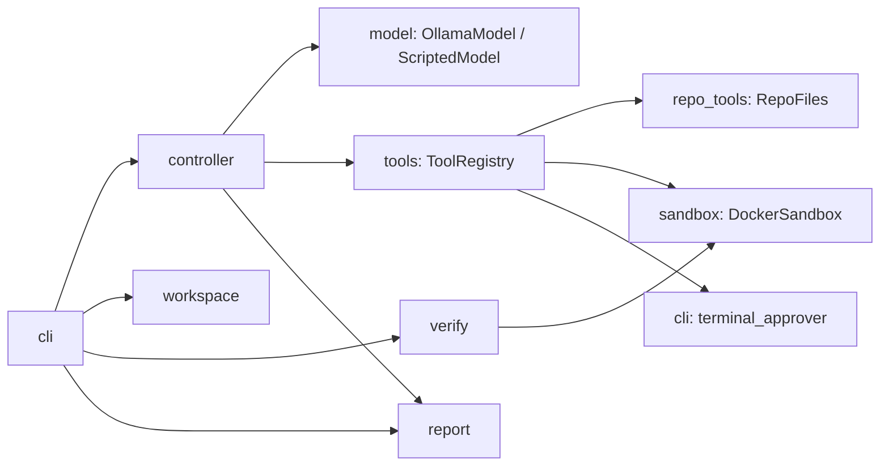
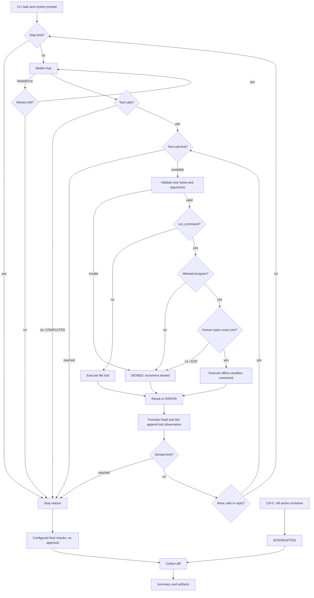
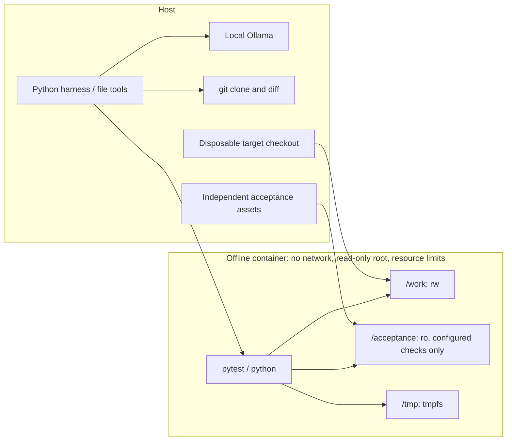

# Architecture

## Components

## Controller loop and final verification

## Sandbox boundary

Only the image build installs dependencies over the network. Model tools do not receive the acceptance mount. Every command uses a fresh container; the writable target checkout persists across calls. Host file tools guard repository paths; Docker bounds command execution. Final checks are independent of the model completion claim.
